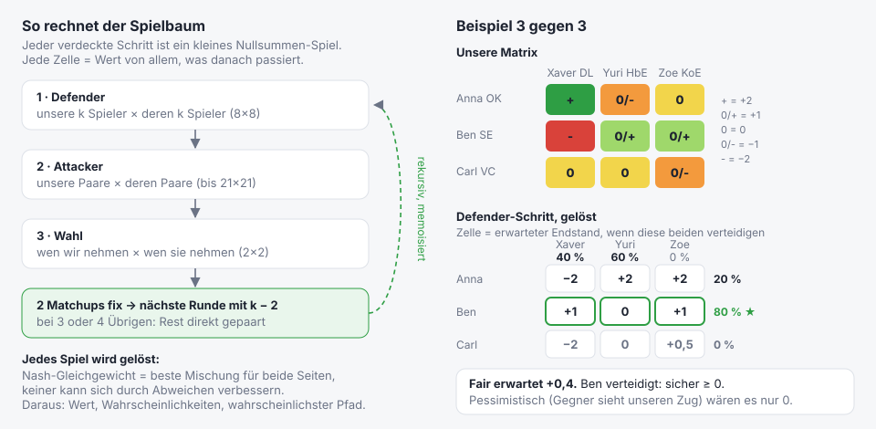

# ProPair

Pairing-Matrix für Tabletop-Teamturniere (The 9th Age). Design: [docs/design.md](docs/design.md).

## Lokal starten

Voraussetzungen: .NET 11 SDK, MongoDB.

```bash
mongod --dbpath .data/mongo --fork --logpath .data/mongod.log
```

```bash
dotnet run --project src/ProPair.Adapters.Rest --launch-profile http
```

App: http://localhost:5054

Sync-Prozess (New Recruit → Mongo, Hangfire):

```bash
dotnet user-secrets set "NewRecruit:Login" "<login>" --id propair
```

```bash
dotnet user-secrets set "NewRecruit:Password" "<passwort>" --id propair
```

```bash
dotnet run --project src/ProPair.Adapters.Sync --launch-profile http
```

Sync: http://localhost:5090 (Dashboard `/hangfire`, nur lokal). Auf Servern: Env-Vars `NewRecruit__Login` / `NewRecruit__Password`.

```bash
dotnet test
```

## New-Recruit-Sync

- Eigener Prozess `ProPair.Adapters.Sync` mit Hangfire (Jobs in Mongo, Prefix `hangfire`). Die API reiht nur ein.
- Täglich 04:00 UTC: Teamturniere „The 9th Age 3rd Edition“ (System 736602462) von heute bis +12 Monate.
- Übersprungen: Einzelturniere, 2er-Teams, geschlossene/vorbei, Ligen (> 4 Tage).
- Listen verborgen: Badge „Keine Listen sichtbar“, letzter bekannter Stand bleibt.
- Liste geändert: Spieler bekommt neue Id → Bewertungen/Notizen für ihn starten neu, Info-Icon in der Matrix.
- Armee: aus dem Listentext (Namen + Übersetzungen FR/DE/ES/IT/PL, sonst typische Einheiten). Leere Listen → „?“.
- „Von New Recruit aktualisieren“ im Turnier (vorerst öffentlich, später Admin-UI).
- Manuell: `POST /sync/upcoming`, `POST /sync/tournaments/{nrId}`, `POST /sync/backfill?from=…&to=…` (auch vergangene, nur zum Testen).
- NR protokolliert jeden Aufruf: Requests nacheinander, 400 ms Pause, ein Worker.

## Stand (POC)

- Turniere aus New Recruit (Sync) plus 4 Demo-Turniere (`FakeTournamentSource`).
- Ablauf: Turnier wählen → eigenes Team wählen → Gegner → Matrix bewerten.
- Edit-/Read-Link ohne Login. Verlauf wird gespeichert, aber noch nicht angezeigt.

## Pairing-Empfehlungen: der Algorithmus



**Was er tut:** Er rechnet für den aktuellen Pairing-Schritt aus, welche Wahl uns am meisten bringt, wenn der Gegner genauso klug spielt. Annahme: Der Gegner bewertet jedes Spiel genau umgekehrt zu unserer Matrix (+2 für uns = −2 für ihn). Unbewertete Felder zählen 0.

**Wie:**
1. **Spielbaum:** Alle Verläufe bis zum Ende (Defender → Attacker → Wahl → nächste Runde). Am Ende jedes Zweigs ist der Endstand bekannt, die Summe der Matrix-Werte.
2. **Jeder verdeckte Schritt ist ein kleines Spiel:** Zeilen = unsere Möglichkeiten, Spalten = die des Gegners, Zelle = Wert von allem, was danach kommt (rekursiv). Größen: Defender 8×8, Attacker-Paare bis 21×21, Wahl 2×2.
3. **Lösung pro Schritt: Nash-Gleichgewicht** (gemischte Strategien, per Simplex). Beide legen verdeckt, also kann keiner auf den anderen reagieren. Das Gleichgewicht ist die Mischung, bei der sich keiner durch Abweichen verbessert. Ergebnis: ein fairer Erwartungswert und für jede Option eine Wahrscheinlichkeit.
4. **Memoisierung:** Zustände zu Rundenbeginn werden über die verbleibenden Spieler (Bitmasken) gecacht. 8v8 mit 3 vorhergesagten Pfaden: ca. 0,7 s.
5. **Ranking der Optionen:** erst Erwartungswert (auf 0,1 gerundet, so wie angezeigt), dann Worst case, dann Wahrscheinlichkeit. Gleich gute Optionen: die sicherere zuerst.
6. **Wahrscheinlichster Pfad:** Ab einer Option folgt er Schritt für Schritt den wahrscheinlichsten Zügen beider Seiten bis zum Ende. Ergebnis: gestrichelte Felder in der Matrix plus Zeitleiste.

**Beispiel (Bild rechts):** Verteidigt Ben, ist uns mindestens 0 sicher. Verteidigt Anna, sind +2 möglich, aber auch −2. Die beste Mischung ist 80 % Ben, 20 % Anna, fair erwartet +0,4. Ein rein pessimistischer Ansatz (der Gegner sieht unseren Zug) käme nur auf 0.

**Austauschbar:**
- `IPairingAdvisor`: der ganze Algorithmus. Die App kennt nur dieses Interface, pro Modus über `IPairingAdvisorProvider`.
- `GameTreeAdvisor(IMatrixGameSolver)`: der Spielbaum. Wie ein einzelner Schritt gelöst wird, entscheidet der Solver:
  - `EquilibriumSolver`: Nash, der Standard.
  - `PessimisticSolver`: Maximin, der Gegner sieht unseren Zug (sichere Untergrenze). Derzeit kein eigener Modus, nur Vergleich/Tests.
- Registriert in `ProPair.Application/DependencyInjection.cs`.

**Modi** (umschaltbar im Empfehlungs-Panel, pro Gerät gemerkt):

| Modus | Was zählt | Technisch |
|-------|-----------|-----------|
| Optimal | höchster fairer Erwartungswert, Plus und Minus gleich gewichtet | Nash, lineare Bewertung |
| Minus vermeiden | schlechte Matchups vermeiden geht vor gute holen | Nash, „-“ zählt 1,5-fach, „0/-“ 1,25-fach (`AdviceModes.MinusFactor`) |

Abgestuft und bewusst moderat: Jeder Minuspunkt bringt 0,25 Aufschlag. Ein „-“ (−2) kostet dann so viel, wie „+“ und „0/+“ zusammen bringen, ein halbes Minus bekommt den halben Aufschlag. Die Gewichtung fließt nur in die Entscheidung ein (`GameTreeAdvisor(solver, weight)`). Alles Angezeigte (Gesamtstand, Matchups, Endstände, Wahrscheinlichkeiten) sind echte Punkte.

**Werte pro Empfehlung:** groß die **Gesamtwertung** (wahrscheinlichster Wert + wie wahrscheinlich genau dieser ist), klein **Diese Runde** (dasselbe für die aktuelle Runde). Exakt berechnet: Ab der Option folgen beide Seiten ihren Strategien (gemischt, jede Möglichkeit mit ihrer Wahrscheinlichkeit). Alle Verläufe werden durchlaufen und die Wahrscheinlichkeiten je Ergebnis aufsummiert, ohne Simulation.

**In der UI:** Das Augen-Symbol schaltet die Empfehlungen ein, standardmäßig sind sie aus. Gerechnet wird nur, wenn sie an sind. Der wahrscheinliche Verlauf erscheint in der Matrix als Ecke oben rechts im Feld: schwarz = nächste Runde, schwarz/hellgrau geteilt = übernächste, hellgrau = dritte. Die Schildchen „Runde 1/2/3“ in der Zeitleiste tragen dieselbe Ecke.

## Offline: local-first Pairing

Im Turnier ist das Netz oft weg. Das Pairing darf deshalb nie am Netz hängen:

- **Logik nur in der Domain:** Pairing-Regeln (`PairingState`) und Empfehlungs-Algorithmus (`IPairingAdvisor`) stehen einmal im Domain-Projekt. Server und Browser laden dieselbe Assembly, die UI ruft sie nur auf.
- **Klicks sind lokal:** Jeder Schritt wird sofort auf dem Gerät mit den Domain-Regeln ausgeführt (`LocalPairing`). Kein Klick wartet auf das Netz.
- **Speichern im Hintergrund:** Die Züge liegen in einer Warteschlange im Browser (localStorage) und gehen als komplette Liste an `PUT …/pairing/moves`, sobald Netz da ist (Retry alle 10 s). Ein Captain trägt ein, deshalb gilt: letzte Liste gewinnt. Der Server spielt sie über die Domain-Regeln nach.
- **Alles vorgerechnet:** Beim Öffnen werden die Rundenwerte beider Modi geladen. Empfehlungen werden pro Modus und Stand gemerkt; nach dem angezeigten Modus rechnet das Gerät den anderen im Hintergrund. Moduswechsel und Rückgängig sind dadurch sofort da.
- **Empfehlungen offline:** Der teure Teil (Wert jedes Rundenstarts, bei 8v8 höchstens 5.685 Zahlen) wird beim Öffnen einmal im Backend vorgerechnet (`GET …/pairing/values?mode=`) und im Browser gecacht. Danach rechnet das Gerät pro Schritt nur noch den aktuellen Schritt nach, ohne Netz.
- **Ohne Netz geöffnet:** Es wird der zuletzt gespeicherte Stand vom Gerät genommen.
- **Zuschauer** (Lese-Link) holen sich den Stand alle 15 s.
- Anzeige unter dem Titel: „Gespeichert“ / „Noch nicht gespeichert – wird gesendet, sobald Netz da ist“ / „Offline“.

- **PWA:** Ein Service Worker cacht die App-Dateien (nur im veröffentlichten Build; im Entwicklungsmodus cacht er absichtlich nichts). Nach dem ersten Besuch startet die App auch ohne Netz, inklusive Neuladen, und lädt den zuletzt gespeicherten Pairing-Stand vom Gerät. Lässt sich auf dem Handy über „Zum Startbildschirm hinzufügen“ wie eine App installieren. Neue Versionen werden beim nächsten Öffnen geladen, nachdem alle Tabs der App geschlossen waren.

Offline testen:

```bash
dotnet publish src/ProPair.Adapters.Rest -c Release -o /tmp/propair
```

```bash
dotnet /tmp/propair/ProPair.Adapters.Rest.dll --contentRoot /tmp/propair --urls http://localhost:5080
```

Seite einmal öffnen, Server stoppen, neu laden.
